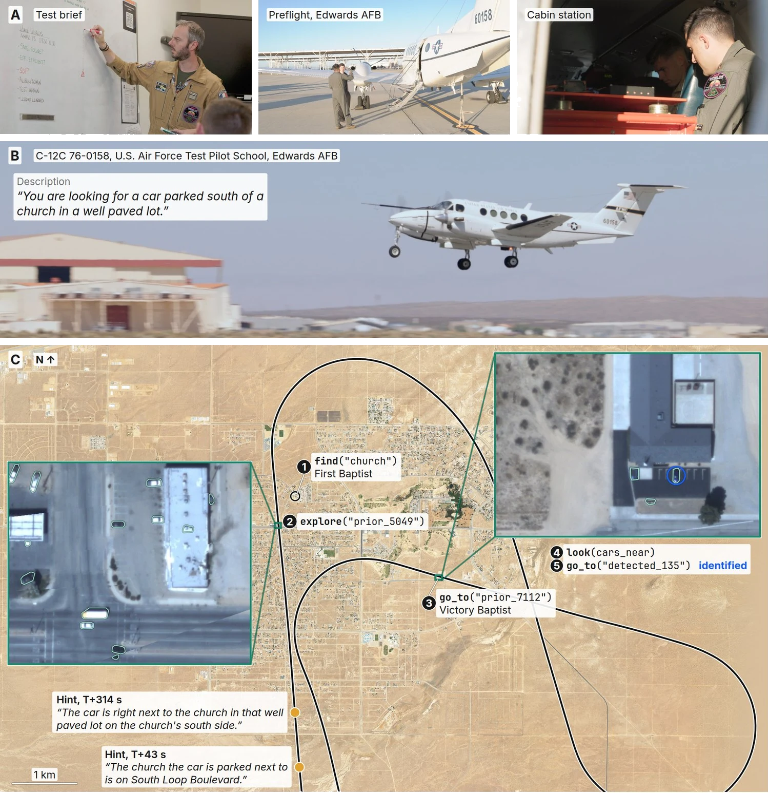
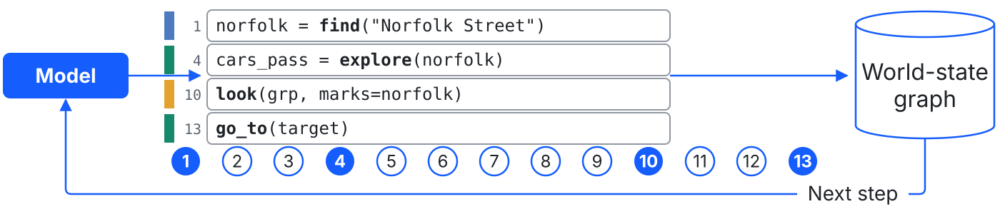

# MAPS: Multimodal Agentic Planning and Search

City-scale agentic search from a crewed aircraft. MAPS searches for objects
described in natural language using a world-state graph built from
OpenStreetMap priors and onboard imagery. The model queries this graph,
directs flight, and configures segmentation of the aircraft's imagery (SAM
3.1) through self-authored short Python programs, without task-specific
training.



*A search flown in closed loop on a C-12. Bottom: the track over California
City, with each call the model wrote at the place it wrote it.*

This repository contains the method, two benchmarks (the public CityNav, and
Cal City), the flight harness, a web console for watching and reviewing
searches, and the readers that derive every reported number from run records.

## Quickstart: review recorded searches

https://github.com/user-attachments/assets/9f7bfc45-4f68-4f71-a20f-6c9af015d0c1

*Quickstart guide to installing MAPS and reviewing a recorded search. All
commands shown below.*

Requires Python 3.12 or later. No model, GPU, or dataset.

1. Install MAPS with the console:

   ```sh
   git clone https://github.com/FinleyHolt/MAPS && cd MAPS
   python -m venv .venv && source .venv/bin/activate
   pip install -e '.[station]'
   ```

2. Download `MAPS-example-runs.zip` from the
   [Releases page](https://github.com/FinleyHolt/MAPS/releases) and unzip it.
   It holds ten Cal City searches: each one's conversation, every picture the
   model was sent, and its score.

3. Open the console on the unzipped folder:

   ```sh
   SEARCH_CALCITY_TILES=<folder>/bake python -m station.serve --bench calcity \
       --out <folder>/runs --basemap <folder>/basemap.jpg
   ```

4. Go to `http://127.0.0.1:8788`. On a mission, click the run count, then the
   run.

On Windows, in PowerShell, activate with `.venv\Scripts\Activate.ps1` and open
the console with:

```powershell
$env:SEARCH_CALCITY_TILES = "<folder>\bake"
python -m station.serve --bench calcity --out <folder>\runs --basemap <folder>\basemap.jpg
```

The review shows the model's reasoning and code turn by turn, the pictures it
was sent, its path on the map, and its score. For the console's other modes,
see [`station/README.md`](station/README.md).

## Run the CityNav benchmark

CityNav ([arXiv:2406.14240](https://arxiv.org/abs/2406.14240)) is the public
benchmark.

### Prerequisites

| Requirement | Details |
|---|---|
| Reasoner | An OpenAI-compatible endpoint, self-hosted or hosted, that serves a model with a card in [`maps/llm/model_cards.py`](maps/llm/model_cards.py). |
| Segmenter | SAM 3.1 on one GPU. The checkpoint `facebook/sam3.1` is gated on Hugging Face. Meta's SAM License covers the checkpoint and the `sam3` package; its section 1.b.v bars ITAR-regulated and military end uses (text in [`THIRD_PARTY_NOTICES.md`](THIRD_PARTY_NOTICES.md#used-and-not-redistributed)). |
| CityNav annotations | Downloaded by the setup script. |
| SensatUrban point clouds | Requested from the authors' [form](https://github.com/QingyongHu/SensatUrban), under CC BY-NC-SA. For the terms, see [`docs/data.md`](docs/data.md#citynav). |

### Steps

1. Prepare the data. The script downloads the annotations, rasterizes the
   point clouds, and bakes the OpenStreetMap prior:

   ```sh
   export CITYNAV_ROOT=~/datasets/citynav-arxiv
   benchmarks/citynav/data_prep/setup.sh --sensaturban <data_release.zip>
   ```

2. Start the segmenter in its own environment, from the repository root:

   ```sh
   micromamba env create -f envs/sam3_1.yml && micromamba activate sam3_1
   pip install git+https://github.com/facebookresearch/sam3@2814fa619404a722d03e9a012e083e4f293a4e53
   HF_TOKEN=<your token> python -m serving.sam_server --port 8772
   ```

3. Point MAPS at the reasoner and check it:

   ```sh
   export SEARCH_REASONER_URL=http://<host>:<port>/v1
   export SEARCH_REASONER_API_KEY=<key>   # if the endpoint requires one
   python -m maps.mission.endpoint_preflight
   ```

4. Fly a split and read the result:

   ```sh
   python -m benchmarks.citynav.bench_fullset --split test_unseen --limit 100 --out-root output/citynav
   python -m benchmarks.citynav.analysis.run_report output/citynav
   ```

   `run_report` prints SR, NE, OSR, and SPL (`spl_pos`, CityNav only). Rerun the first command to resume
   an interrupted run.

5. Review the searches, or fly one from the console:

   ```sh
   python -m station.serve --bench citynav --out output/citynav
   ```

For data details, see [`docs/data.md`](docs/data.md). For endpoints and their
environment variables, see [`docs/endpoints.md`](docs/endpoints.md). For the
run root's layout and the driver's flags, see
[`benchmarks/citynav`](benchmarks/citynav/README.md).

## How it works

A search is one conversation with one model. The model has one tool, `run`,
whose argument is a block of Python. Each block reads or extends the
world-state graph, and its printed output returns to the model, which then
writes the next block. The search ends when the model replies without a tool
call; the answer is the target of its last flight.

<picture>
  <source media="(prefers-color-scheme: dark)" srcset="docs/figures/how-it-works-dark.svg">
  
</picture>

*One search of 13 steps. The model finds a street in the map, flies a pass
over it, looks at the cars the pass detected, and flies to the one it picks.*

The world-state graph holds everything the search knows as rows: map features
from OpenStreetMap, and the objects that the segmenter detects on each flight.
The model's Python calls this library:

| Call | Description |
|---|---|
| `find` | Reads rows of the world state by name or class, ordered or cut by place, side, and colour. |
| `look_for` | Names up to four classes for the segmenter to detect on later flights. With `at=<place>`, also segments that place for them: a place not yet flown on the next flight there; on the bench, a stop already flown at once. |
| `go_to` | Flies to one row. |
| `explore` | Flies a covering pass over a row or a set, and returns the rows it detected. |
| `look` | Returns a close crop of the sensor's pixels at a row. |
| `show_map` | Returns a schematic of the world state around a place. |
| `stand` | Sets a ground viewpoint, without flying, that later rows and pictures face. |
| `intersection`, `ends_of`, `distance` | Road crossings, road ends, and metres between footprints. |
| `more_of` | Returns the next block of a long result. |

Only `go_to` and `explore` move the aircraft. The model's Python runs in the
mission's own process; see [Security](#security).

To print the exact system turn and tool schema that the model receives:

```sh
python -m maps.mission.contract --sensor oryx_orx32_25mm_nadir
```

For the code behind each part, see [`maps/README.md`](maps/README.md) and
[`docs/architecture.md`](docs/architecture.md).

## Security

The `run` tool executes model-written Python inside the process that flies the
mission. The interpreter's block scan and line ceilings keep a cooperative
model on the library; a hostile block reaches `os`, `subprocess`, and the file
system through Python's reflection.

Each entry point that runs model code isolates it as far as its host allows
and logs a `sandbox:` line (`benchmarks/sandbox.py`). The entry points are
the bench driver's attempts, and the station, the twin CLI, and the runner
started from the command line.

| Layer | Bench attempt | Station, twin CLI, runner |
|---|---|---|
| Memory cap (`RLIMIT_DATA`, Linux) | 4 GiB, `--attempt-memory-gib` | 16 GiB (runner 4 GiB), `--memory-gib` |
| Memory and processes (systemd user scope) | `MemoryMax` at the cap, shared memory and child processes included. Every process is killed with the attempt. | None |
| Environment | An allowlist: MAPS's own variables, the reasoner key, Hugging Face settings without the token, locale, paths, proxies, and one thread per native pool | The same allowlist, after a restart |
| File system: hidden (bubblewrap) | Home, `/tmp`, `/dev/shm`, and `/run` empty; the repo's `.env` and the Hugging Face token masked | Same |
| File system: read-only (bubblewrap) | `/`, the repo, the interpreter, the bench's data, the config, the Hugging Face hub cache (offline) | `/`, the repo, the interpreter, the bench's data, every path argument, the hub cache (offline) when the process flies |
| File system: writable (bubblewrap) | The worker's attempt root, the ortho cache | `--out`; the ortho caches when the process flies |
| Processes (bubblewrap) | Own PID namespace and session | Own PID namespace |
| Network | Shared with the host | Shared with the host |

The systemd scope applies to bench attempts only. A process that flies caches
the reasoner's tokenizer before it confines itself, so a reasoner first
reached after the station starts needs its tokenizer in the hub cache already
(`python -m maps.mission.endpoint_preflight` caches it). Until then a station
under bubblewrap refuses each mission with that command. Once it has run, the
next mission flies where the hub cache directory existed when the station
started, and after a station restart otherwise.

The layers that apply depend on the host:

| Host | Layers |
|---|---|
| `bwrap` runs and a systemd user manager starts scopes (a desktop Linux) | All |
| `bwrap` runs, no user manager | All but the scope: shared memory, a child process, and a daemon that leaves the attempt's session escape the cap |
| User namespaces blocked, systemd user manager present (Ubuntu 24.04's AppArmor default) | Memory cap and scope. The scope binds a cooperative block only: a block reaches the user manager and can lift its own `MemoryMax` or start units outside the scope. The environment allowlist binds a cooperative block only: with no PID namespace, a block reads the launching shell's environment from its ancestors in `/proc`. |
| No `bwrap`, no user manager (a typical HPC compute node) | Memory cap: shared memory, a child process, and a daemon that leaves the attempt's session escape the cap. The environment allowlist binds a cooperative block only, as above. |
| macOS | The environment allowlist alone, binding a cooperative block only: no memory cap (macOS does not enforce `RLIMIT_DATA`), no scope, no bubblewrap. |
| Windows | Review only: the station serves recorded runs, and every entry point that flies model code refuses. |

A block that allocates past the cap gets `MemoryError` as its block error, and
the mission continues. A `MemoryError` raised outside a block, in the
harness, books the attempt as infrastructure. An allocation that fails in
native code (a Rust tokenizer's abort, the scope's out-of-memory kill) ends
the attempt with a signal, which the driver books as infrastructure and flies
again.

The network stays shared because the mission calls the reasoner and the
segmenter over HTTP. A block therefore reaches any host the machine reaches,
the host's abstract Unix sockets, and the reasoner's key in the process
environment. An X server that admits the user's uid over its abstract socket
hands an escaped block the desktop, keystroke injection included.

The attempt also scores itself. A block that escapes the library can rewrite
its own score and the caches later attempts read: the ortho cache is shared
across attempts, and its stamp is a file the block can forge. To fly a model
you don't trust, or to report benchmark numbers from one, run MAPS in a
container or a virtual machine whose egress reaches only the reasoner and the
segmenter.

The SAM serve (`python -m serving.sam_server`) binds `0.0.0.0` with no
authentication by default, so any host that reaches its port can use the GPU
behind it. On a shared network, start it with `--host 127.0.0.1` and reach it
through an SSH tunnel.

## Reproduce the paper

- The main branch reproduces the CityNav and Cal City runs of the full
  method. For the commands and readers, see
  [`docs/experiments.md`](docs/experiments.md).
- The ablation arms, the comparison against the baselines, and the as-flown
  replay reproduce from the tag
  [`paper-v1`](https://github.com/FinleyHolt/MAPS/tree/paper-v1)
  (`git checkout paper-v1`).

## Fly the twin

The kinematic twin flies a Cal City mission through the flight harness
without an aircraft:

```sh
python -m benchmarks.flight.twin --config configs/calcity.yaml --episode 'calcity::6#6' --ortho <root>/data/rgbd_upstream
```

See [`docs/flight.md`](docs/flight.md).

## Citation

```bibtex
@software{holt2026maps,
  title   = {MAPS},
  author  = {Holt, Finley R.},
  year    = {2026},
  version = {0.1.0},
  url     = {https://github.com/FinleyHolt/MAPS}
}
```

MAPS evaluates on CityNav (Lee et al.,
[arXiv:2406.14240](https://arxiv.org/abs/2406.14240)), built on SensatUrban and
CityRefer; cite them as well. [`CITATION.cff`](CITATION.cff) carries the same
record.

## License

MIT; see [`LICENSE`](LICENSE). Third-party code and data are listed in
[`THIRD_PARTY_NOTICES.md`](THIRD_PARTY_NOTICES.md).
