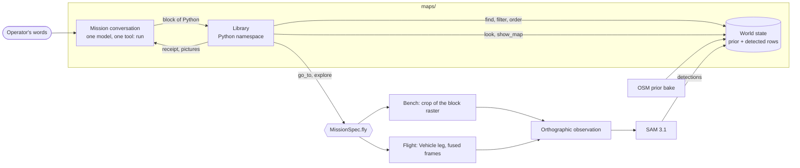

# MAPS: Multimodal Agentic Planning and Search

MAPS is a method for aerial language-guided target search. An operator
describes a target in words ("the car parked north of the church"), and a
multimodal language model flies an aircraft to find it by writing Python
against a small library over a structured world state: an OpenStreetMap
prior joined with the detections of an open-vocabulary segmenter (SAM 3.1).
This repository holds the method, the two benchmarks it is measured on (the
public CityNav, and Cal City), the flight harness that flew it in closed
loop on a C-12, and the readers that derive every reported number from run
records.

The model acts through one tool, `run`, whose argument is a block of
Python. The block calls this library:

| Call | What it does |
|---|---|
| `find` | Reads rows of the world state (the OSM prior plus every detection) by name or class, ordered or cut by place, side and colour. |
| `look_for` | Names up to four classes the segmenter detects on every later flight. |
| `go_to` | Flies to one thing on the map. |
| `explore` | Flies a covering pass over a thing or a set, segmenting at every stop, and returns the rows it found. |
| `look` | Returns a close crop of the sensor's pixels at a row, as a picture. |
| `show_map` | Returns the world-state map around a place, drawn as a schematic. |
| `stand` | Adopts a ground viewpoint, without flying, that later rows and pictures face. |
| `more_of` | Returns the next block of a long result. |
| `intersection` | Returns where two roads cross. |
| `ends_of` | Returns where a road ends, one row per terminus. |
| `distance` | Returns the metres between two footprints. |

A result is a set of rows with `.filter` (a cut) and `.order` (one sort
key). Only `go_to` and `explore` move the aircraft.

## See it

This takes minutes and needs no model, GPU or data. Install MAPS with the
`station` extra (Python 3.12 or later):

```sh
git clone https://github.com/FinleyHolt/MAPS && cd MAPS
python -m venv .venv && source .venv/bin/activate
pip install -e '.[station]'
```

Download `MAPS-example-runs.zip` from the Releases page of this repository
and unzip it. It holds recorded Cal City missions: each run's conversation,
the pictures the model saw and its score. Open the station on the folder it
unpacks to (the archive's own README gives the exact command):

```sh
SEARCH_CALCITY_TILES=<folder>/bake python -m station.serve --out <folder>/runs --basemap <folder>/basemap.jpg
```

Then open `http://127.0.0.1:8788`, pick a run and scrub through it.
[`station/README.md`](station/README.md) describes the console.

## Run it on CityNav

CityNav (Lee et al., [arXiv:2406.14240](https://arxiv.org/abs/2406.14240))
is the public benchmark. A run takes three things:

| You need | What | Notes |
|---|---|---|
| A reasoner | Any OpenAI-compatible endpoint, self-hosted or hosted, serving a model that has a card in [`maps/llm/model_cards.py`](maps/llm/model_cards.py). | [`docs/endpoints.md`](docs/endpoints.md) lists the cards and variables. |
| The segmenter | SAM 3.1 on one GPU, served from this repository. | The checkpoint `facebook/sam3.1` is gated on Hugging Face. |
| The data | CityNav's annotations, fetched by script, and the SensatUrban point clouds, which you request from their authors' [form](https://github.com/QingyongHu/SensatUrban). | SensatUrban is CC BY-NC-SA, non-commercial research use, no redistribution, which is why this repository ships no raster or picture made from it. |

Prepare the data, in the environment above ([`docs/data.md`](docs/data.md)):

```sh
export CITYNAV_ROOT=~/datasets/citynav-arxiv
benchmarks/citynav/data_prep/setup.sh --sensaturban <data_release.zip>
```

Start the SAM serve in its own environment, from the repository root:

```sh
micromamba env create -f envs/sam3_1.yml && micromamba activate sam3_1
pip install <a checkout of Meta's SAM 3 source>
HF_TOKEN=<your token> python -m serving.sam_server --port 8772
```

Point MAPS at a reasoner and check it:

```sh
export SEARCH_REASONER_URL=http://<host>:<port>/v1
export SEARCH_REASONER_API_KEY=<key>              # where the endpoint takes one
python -m maps.mission.endpoint_preflight
```

Fly a split, then read the run root:

```sh
python -m benchmarks.citynav.bench_fullset --split test_unseen --limit 100 --out-root output/citynav
python -m benchmarks.citynav.analysis.run_report output/citynav
```

`run_report` prints SR, NE, SPL and OSR for the root. Rerunning the
`bench_fullset` command resumes it. Each attempt's directory under the root
holds its conversation (`conversation.jsonl`); see
[`benchmarks/citynav`](benchmarks/citynav/README.md) for the root's layout
and the driver's flags.

## How it works



**The mission conversation** (`maps/mission/loop.py`). A search is one
conversation with one model. It receives a system turn and the operator's
words, and each `run` block executes in a Python namespace that persists
for the whole mission. `print()` output and the block's last value come
back as the tool result, the receipt. The mission ends when the model
replies without a tool call; the commit is the target of its last flight.

**The library** (`maps/library/`). The calls in the table above are the
namespace's builtins. Reading calls compile onto an op program
(`maps/query/`); a result is a handle that is re-derived over the current
world state on every read, so a `find` bound before a flight holds that
flight's rows after it.

**The structured world state** (`maps/world_state/`). One graph holds every
thing the mission knows. A row is one node: a fid, a point and footprint in
local metres, and either OSM tags and a name (a prior row, from the bake of
an OpenStreetMap extract) or a class label (a detected row, from the
segmenter), plus the colour a flight has seen on it. The prior seeds the
graph before the first flight; each flight folds its detections in as rows
of the same kind. `find` reads rows and never changes them, `look_for`
names the classes later flights segment, `explore` and `go_to` extend the
graph with what a flight detects, and `look` returns the pixels flights
have collected at a row. A planner or another autonomy stack integrates
against this interface: it supplies moves and observations on one side and
reads typed, georeferenced rows on the other.

**Perception** (`maps/perception/`, `serving/`). Each flight's view is a
north-up orthophoto of the ground under the aircraft. SAM 3.1 segments it
for the watched classes, and a world tracker keeps one row per object
across flights.

**Two ways a flight happens.** On a bench, a move sets the pose and the
observation is a crop of the block's raster
(`benchmarks/citynav/run_benchmark/mission_engine.py`). In flight, a move
is a leg posted through the `Vehicle` protocol
(`benchmarks/flight/vehicle.py`) to a real aircraft or to the kinematic
twin, and the observation is fused from the camera frames the aircraft
recorded. Both end in the same segment, fold and report path.

[`docs/architecture.md`](docs/architecture.md) follows one mission through
the code. Print the served contract (the system turn and the tool schema
the model receives) with:

```sh
python -m maps.mission.contract --sensor oryx_orx32_25mm_nadir
```

## Reproduce the paper

[`docs/experiments.md`](docs/experiments.md) lists each experiment, the
command that flies each arm and the reader that derives each number.
CityNav experiments run on the setup above. The Cal City bench needs a map
raster and an OSM bundle that this repository does not ship
([`docs/data.md`](docs/data.md#cal-city)). The closed-loop flight's
recordings are not distributed; its measures and their reader are in
`docs/experiments.md`, and
[`docs/differences-from-flight.md`](docs/differences-from-flight.md) lists
every place this engine differs from the engine as flown.

## Bring your own aircraft

The flight harness reaches an aircraft through one protocol, `Vehicle`:
post a leg, read poses and recorded frames. Implement it for your aircraft
and the mission, the observation chain and the station run over it. The
twin flies a Cal City mission through the same harness with no aircraft:

```sh
python -m benchmarks.flight.twin --config configs/calcity.yaml --episode 'calcity::6#6' --ortho <root>/data/rgbd_upstream
```

[`docs/flight.md`](docs/flight.md) covers the harness, the twin, the replay
of a flown run and the steps for an aircraft of your own.

## Repository layout

| Path | Contents |
|---|---|
| [`maps/`](maps/README.md) | The method: mission loop, library, op program, world state, perception client, render, LLM transport. |
| [`benchmarks/citynav/`](benchmarks/citynav/README.md) | The CityNav bench: driver, runner, scoring, prior bake, data preparation, and the episode engine both benches fly. |
| [`benchmarks/citynav/analysis/`](benchmarks/citynav/analysis/README.md) | The run readers every number is derived with. |
| [`benchmarks/calcity/`](benchmarks/calcity/README.md) | The Cal City bench: corpus, reviewed set, raster and bake build. |
| [`benchmarks/flight/`](benchmarks/flight/README.md) | The flight harness, the twin, as-flown replay and the closed-loop measures. |
| `benchmarks/bench.py` | A bench as a value: its data roots, splits, success criterion, tile bake and episode engine. |
| `benchmarks/run_record/` | The run record both benches and the flight harness write: ledger, attempt directory, manifest, config, attempt pick. |
| [`station/`](station/README.md) | The station: a web console over a twin mission and over finished runs. |
| `serving/` | The SAM 3.1 serve. |
| `configs/` | Bench configs: the CityNav control, Cal City, and the withhold arms. |
| `envs/` | The SAM 3.1 serve environment. |
| `tiles/osm_cache/` | The OpenStreetMap cache per CityNav city, the bake's source. |
| [`docs/`](docs/architecture.md) | Architecture, endpoints, data, experiments, flight, differences from the engine as flown. |

## Citation

```bibtex
@software{holt2026maps,
  title   = {MAPS},
  author  = {Holt, Finley R.},
  year    = {2026},
  version = {0.1.0},
  url     = {https://github.com/FinleyHolt/MAPS}
}
```

MAPS evaluates on CityNav (Lee et al.,
[arXiv:2406.14240](https://arxiv.org/abs/2406.14240)), built on SensatUrban and
CityRefer; cite them as well. [`CITATION.cff`](CITATION.cff) carries the same
record.

## License

MIT; see [`LICENSE`](LICENSE). Third-party code and data are listed in
[`THIRD_PARTY_NOTICES.md`](THIRD_PARTY_NOTICES.md).
